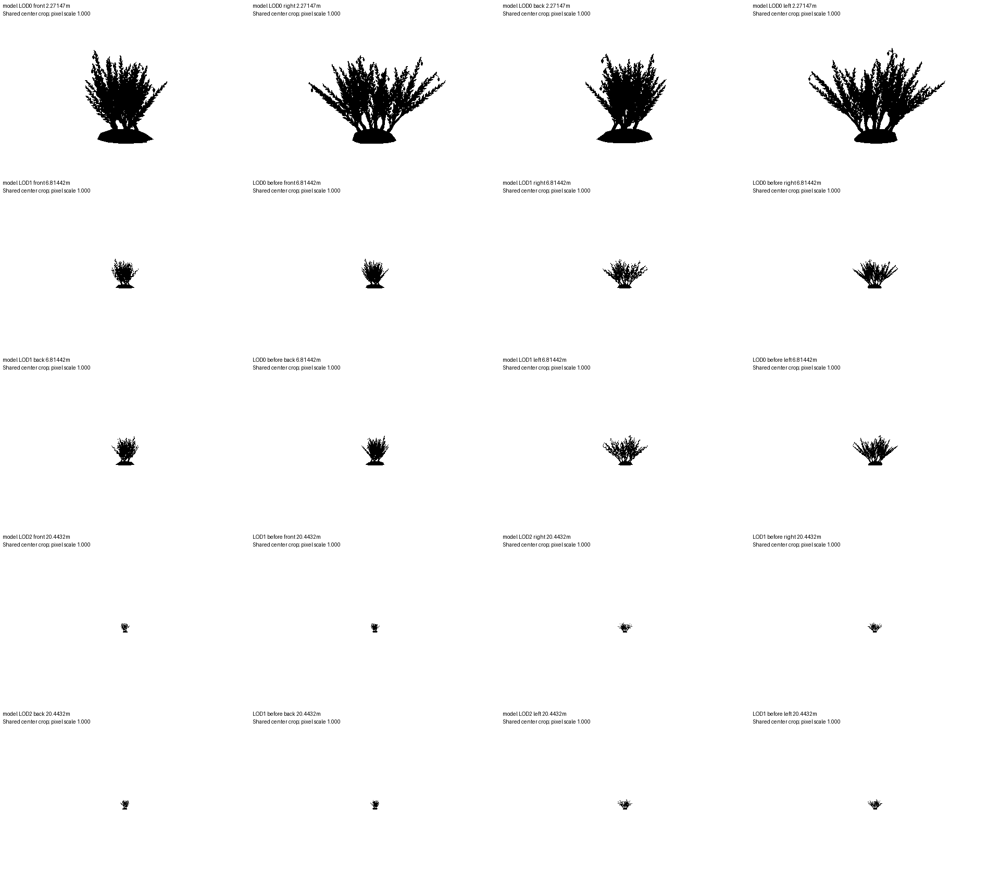

# Model QA

Result: **FAIL**

Mechanical QA only; artistic quality and in-game transitions still need human review.

| Model | LOD | Check | Result | Measurements |
|---|---:|---|---|---|
| specimen-a | 0 | M12 | PASS | 0 floating / 1435 parts; 1 poses; 3 mm |
| specimen-a | 0 | M13 | PASS | max 0 major, 0 minor; limit 2/100 parts; 1 poses |
| specimen-a | 0 | M5 | FAIL | max XOR/union=0.000000 / 0.05; 0 missing parts; distance=2.27147m; declared=False |
| specimen-a | 0 | triangles | FAIL | 10442 / 5000 triangles |
| specimen-a | 0 | ecology | FAIL | habitat=False; reasoned traits=0 |
| specimen-a | 1 | M12 | PASS | 0 floating / 741 parts; 1 poses; 3 mm |
| specimen-a | 1 | M13 | PASS | max 0 major, 0 minor; limit 2/100 parts; 1 poses |
| specimen-a | 1 | M5 | FAIL | max XOR/union=0.209769 / 0.05; 1277 missing parts; distance=6.81442m; declared=False |
| specimen-a | 1 | triangles | FAIL | 5931 / 5000 triangles |
| specimen-a | 1 | ecology | FAIL | habitat=False; reasoned traits=0 |
| specimen-a | 2 | M12 | PASS | 0 floating / 392 parts; 1 poses; 3 mm |
| specimen-a | 2 | M13 | PASS | max 0 major, 0 minor; limit 2/100 parts; 1 poses |
| specimen-a | 2 | M5 | FAIL | max XOR/union=0.244240 / 0.05; 348 missing parts; distance=20.4432m; declared=False |
| specimen-a | 2 | triangles | PASS | 3917 / 5000 triangles |
| specimen-a | 2 | ecology | FAIL | habitat=False; reasoned traits=0 |

## Inputs

- `model-lod0.glb`: `4af1bb8de22e7d182da1ad895eb988f2975170f26015c77ae937774a0a6f6001`
- `model-lod1.glb`: `d1b1c8900b1c4d0237df7bc92f8f1b4d46bd2a828d9a91bab9f893a801d410fb`
- `model-lod2.glb`: `a3488ca02540a3419e20fe2ba133b7d09d3657441d2a770a9996bfe4c7d23597`

## Settings

```json
{
  "budget_tris": 5000,
  "switch_distances": null,
  "max_pixel_difference": 0.05,
  "part_match_mm": 3.0,
  "samples": 6,
  "width": 1920,
  "height": 1080,
  "fov": 75
}
```

## Limits

- M12 uses 3 mm contact; M13 fails on any major or more than two minor clips per 100 parts.
- M5 pixel fraction is XOR / union at identical cameras for each adjacent pair. The configured threshold is a mechanical QA policy, not a calibrated perceptual pass.
- Part correspondence flags parts with at most half their vertices near the next LOD surface. This can also flag a moved or strongly simplified part; inspect the named geometry.
- Silhouettes measure opaque geometry, not alpha textures, materials, animation blending, runtime fades or engine visibility ranges.
- Missing switch distances fail M5. Fallback distances produce diagnostic images only.
- Ecology checks document structure, not biological truth.

## Failures and flagged parts

### specimen-a LOD0 M5

```json
{
  "switch_distance_m": 2.271472013224132,
  "distance_declared": false,
  "valid_chain": true,
  "views": [
    {
      "side": "front",
      "different_pixels": 0,
      "union_pixels": 13200,
      "difference_fraction": 0.0,
      "before_pixels": 13200,
      "after_pixels": 13200,
      "frame_clipped": false
    },
    {
      "side": "right",
      "different_pixels": 0,
      "union_pixels": 16279,
      "difference_fraction": 0.0,
      "before_pixels": 16279,
      "after_pixels": 16279,
      "frame_clipped": false
    },
    {
      "side": "back",
      "different_pixels": 0,
      "union_pixels": 12423,
      "difference_fraction": 0.0,
      "before_pixels": 12423,
      "after_pixels": 12423,
      "frame_clipped": false
    },
    {
      "side": "left",
      "different_pixels": 0,
      "union_pixels": 16482,
      "difference_fraction": 0.0,
      "before_pixels": 16482,
      "after_pixels": 16482,
      "frame_clipped": false
    }
  ],
  "disappeared_parts": []
}
```

### specimen-a LOD0 triangles

```json
{}
```

### specimen-a LOD0 ecology

```json
{
  "result": "FAIL",
  "habitat": "",
  "traits_with_reason": [],
  "sha256": null,
  "reason": "Ecology entry is missing"
}
```

### specimen-a LOD1 M5

```json
{
  "switch_distance_m": 6.8144160396723965,
  "distance_declared": false,
  "valid_chain": true,
  "views": [
    {
      "side": "front",
      "different_pixels": 233,
      "union_pixels": 1473,
      "difference_fraction": 0.1581805838424983,
      "before_pixels": 1375,
      "after_pixels": 1338,
      "frame_clipped": false
    },
    {
      "side": "right",
      "different_pixels": 377,
      "union_pixels": 1926,
      "difference_fraction": 0.19574247144340604,
      "before_pixels": 1779,
      "after_pixels": 1696,
      "frame_clipped": false
    },
    {
      "side": "back",
      "different_pixels": 202,
      "union_pixels": 1426,
      "difference_fraction": 0.14165497896213183,
      "before_pixels": 1350,
      "after_pixels": 1300,
      "frame_clipped": false
    },
    {
      "side": "left",
      "different_pixels": 408,
      "union_pixels": 1945,
      "difference_fraction": 0.20976863753213368,
      "before_pixels": 1780,
      "after_pixels": 1702,
      "frame_clipped": false
    }
  ],
  "disappeared_parts": [
    {
      "part": 0,
      "name": "specimen-a-mesh / part-0",
      "retained_vertex_fraction": 0.38461538461538464,
      "nearest_surface_mm": 0.0,
      "farthest_surface_mm": 24.100832343383964,
      "centroid_m": [
        -0.00032788209390988707,
        -0.013122300141393078,
        0.0021080217201758645
      ],
      "triangles": 100
    },
    {
      "part": 63,
      "name": "specimen-a-mesh / part-63",
      "retained_vertex_fraction": 0.4,
      "nearest_surface_mm": 0.0,
      "farthest_surface_mm": 5.2970172606741155,
      "centroid_m": [
        -0.028458124721117153,
        0.17406160159657263,
        0.011239604009786311
      ],
      "triangles": 4
    },
    {
      "part": 64,
      "name": "specimen-a-mesh / part-64",
      "retained_vertex_fraction": 0.2,
      "nearest_surface_mm": 1.7447919410691064,
      "farthest_surface_mm": 9.370316613406766,
      "centroid_m": [
        -0.022629587500598215,
        0.17561754123278064,
        0.028897698738077734
      ],
      "triangles": 4
    },
    {
      "part": 65,
      "name": "specimen-a-mesh / part-65",
      "retained_vertex_fraction": 0.4,
      "nearest_surface_mm": 0.0,
      "farthest_surface_mm": 5.98375773752982,
      "centroid_m": [
        -0.01305976935674224,
        0.18849916926252064,
        0.018415406534629468
      ],
      "triangles": 4
    },
    {
      "part": 66,
      "name": "specimen-a-mesh / part-66",
      "retained_vertex_fraction": 0.2,
      "nearest_surface_mm": 1.6725703562097398,
      "farthest_surface_mm": 11.312143453220516,
      "centroid_m": [
        -0.02613646848219985,
        0.19969117258873828,
        0.02660282248601266
      ],
      "triangles": 4
    },
    {
      "part": 67,
      "name": "specimen-a-mesh / part-67",
      "retained_vertex_fraction": 0.4,
      "nearest_surface_mm": 0.0,
      "farthest_surface_mm": 6.595583638498033,
      "centroid_m": [
        -0.008777001579838406,
        0.19973265930948655,
        0.03959829929245907
      ],
      "triangles": 4
    },
    {
      "part": 68,
      "name": "specimen-a-mesh / part-68",
      "retained_vertex_fraction": 0.4,
      "nearest_surface_mm": 1.6581786931783158,
      "farthest_surface_mm": 11.327788086059055,
      "centroid_m": [
        -0.012212484818882171,
        0.21758542621914426,
        0.026009732316794074
      ],
      "triangles": 4
    },
    {
      "part": 69,
      "name": "specimen-a-mesh / part-69",
      "retained_vertex_fraction": 0.2,
      "nearest_surface_mm": 1.6054409126914555,
      "farthest_surface_mm": 9.491294509122353,
      "centroid_m": [
        0.004397237940300511,
        0.22685707303557456,
        0.042223205715229445
      ],
      "triangles": 4
    },
    {
      "part": 71,
      "name": "specimen-a-mesh / part-71",
      "retained_vertex_fraction": 0.2,
      "nearest_surface_mm": 1.7166778099624609,
      "farthest_surface_mm": 13.929136400232101,
      "centroid_m": [
        0.001787646522324569,
        0.24010734658043992,
        0.06124994188864962
      ],
      "triangles": 4
    },
    {
      "part": 72,
      "name": "specimen-a-mesh / part-72",
      "retained_vertex_fraction": 0.2,
      "nearest_surface_mm": 1.7903664926727536,
      "farthest_surface_mm": 11.295240316931281,
      "centroid_m": [
        -0.030616968230229174,
        0.11020596168224925,
        -0.03763570946737795
      ],
      "triangles": 4
    },
    {
      "part": 73,
      "name": "specimen-a-mesh / part-73",
      "retained_vertex_fraction": 0.2,
      "nearest_surface_mm": 1.6733874285282488,
      "farthest_surface_mm": 11.421525214011725,
      "centroid_m": [
        -0.026221467270445085,
        0.13388925799300003,
        -0.03877545443075119
      ],
      "triangles": 4
    },
    {
      "part": 75,
      "name": "specimen-a-mesh / part-75",
      "retained_vertex_fraction": 0.4,
      "nearest_surface_mm": 0.0,
      "farthest_surface_mm": 6.123899816247042,
      "centroid_m": [
        -0.05990678230984515,
        0.15071364875713827,
        -0.0068666438472442925
      ],
      "triangles": 4
    },
    {
      "part": 76,
      "name": "specimen-a-mesh / part-76",
      "retained_vertex_fraction": 0.2,
      "nearest_surface_mm": 1.7289515603514067,
      "farthest_surface_mm": 11.182437995491323,
      "centroid_m": [
        -0.05475482413964256,
        0.1616809627909598,
        -0.024987780326953802
      ],
      "triangles": 4
    },
    {
      "part": 77,
      "name": "specimen-a-mesh / part-77",
      "retained_vertex_fraction": 0.4,
      "nearest_surface_mm": 0.0,
      "farthest_surface_mm": 6.8010577513099095,
      "centroid_m": [
        -0.07522873391512268,
        0.16287293930191643,
        -0.019893366820839226
      ],
      "triangles": 4
    },
    {
      "part": 78,
      "name": "specimen-a-mesh / part-78",
      "retained_vertex_fraction": 0.2,
      "nearest_surface_mm": 1.595152442482463,
      "farthest_surface_mm": 13.527633386242483,
      "centroid_m": [
        -0.06631582245081633,
        0.18035922230909895,
        -0.009867843468759376
      ],
      "triangles": 4
    },
    {
      "part": 79,
      "name": "specimen-a-mesh / part-79",
      "retained_vertex_fraction": 0.4,
      "nearest_surface_mm": 0.0,
      "farthest_surface_mm": 7.278280633555545,
      "centroid_m": [
        -0.07573052504132652,
        0.18230386458504297,
        -0.033333193630286195
      ],
      "triangles": 4
    },
    {
      "part": 80,
      "name": "specimen-a-mesh / part-80",
      "retained_vertex_fraction": 0.2,
      "nearest_surface_mm": 1.721769146886737,
      "farthest_surface_mm": 10.865789564647937,
      "centroid_m": [
        -0.08480293290856157,
        0.19190418808520993,
        -0.011880600336480564
      ],
      "triangles": 4
    },
    {
      "part": 81,
      "name": "specimen-a-mesh / part-81",
      "retained_vertex_fraction": 0.4,
      "nearest_surface_mm": 0.0,
      "farthest_surface_mm": 7.4987785245442575,
      "centroid_m": [
        -0.07189941795996604,
        0.20722422009506686,
        -0.02465312429595682
      ],
      "triangles": 4
    },
    {
      "part": 82,
      "name": "specimen-a-mesh / part-82",
      "retained_vertex_fraction": 0.4,
      "nearest_surface_mm": 0.0,
      "farthest_surface_mm": 7.4363326340428655,
      "centroid_m": [
        -0.09398246624442311,
        0.21812709648602818,
        -0.014204897304184642
      ],
      "triangles": 4
    },
    {
      "part": 83,
      "name": "specimen-a-mesh / part-83",
      "retained_vertex_fraction": 0.4,
      "nearest_surface_mm": 0.0,
      "farthest_surface_mm": 7.098376649263466,
      "centroid_m": [
        -0.11115474890334177,
        0.2270913231913011,
        -0.02767485820860902
      ],
      "triangles": 4
    }
  ],
  "additional_flagged_parts": 1257,
  "full_evidence": "report.json"
}
```

### specimen-a LOD1 triangles

```json
{}
```

### specimen-a LOD1 ecology

```json
{
  "result": "FAIL",
  "habitat": "",
  "traits_with_reason": [],
  "sha256": null,
  "reason": "Ecology entry is missing"
}
```

### specimen-a LOD2 M5

```json
{
  "switch_distance_m": 20.44324811901719,
  "distance_declared": false,
  "valid_chain": true,
  "views": [
    {
      "side": "front",
      "different_pixels": 35,
      "union_pixels": 162,
      "difference_fraction": 0.21604938271604937,
      "before_pixels": 148,
      "after_pixels": 141,
      "frame_clipped": false
    },
    {
      "side": "right",
      "different_pixels": 53,
      "union_pixels": 217,
      "difference_fraction": 0.24423963133640553,
      "before_pixels": 193,
      "after_pixels": 188,
      "frame_clipped": false
    },
    {
      "side": "back",
      "different_pixels": 35,
      "union_pixels": 161,
      "difference_fraction": 0.21739130434782608,
      "before_pixels": 143,
      "after_pixels": 144,
      "frame_clipped": false
    },
    {
      "side": "left",
      "different_pixels": 48,
      "union_pixels": 218,
      "difference_fraction": 0.22018348623853212,
      "before_pixels": 197,
      "after_pixels": 191,
      "frame_clipped": false
    }
  ],
  "disappeared_parts": [
    {
      "part": 0,
      "name": "specimen-a-mesh / part-0",
      "retained_vertex_fraction": 0.4230769230769231,
      "nearest_surface_mm": 0.0,
      "farthest_surface_mm": 56.900571892839295,
      "centroid_m": [
        -0.0005776599655538789,
        -0.014172352159025415,
        0.004142982974935791
      ],
      "triangles": 48
    },
    {
      "part": 64,
      "name": "specimen-a-mesh / part-64",
      "retained_vertex_fraction": 0.5,
      "nearest_surface_mm": 0.8926261174146843,
      "farthest_surface_mm": 14.836940564314153,
      "centroid_m": [
        -0.010832657887081085,
        0.19146775620870246,
        0.018271467948010517
      ],
      "triangles": 2
    },
    {
      "part": 68,
      "name": "specimen-a-mesh / part-68",
      "retained_vertex_fraction": 0.25,
      "nearest_surface_mm": 1.028595366195745,
      "farthest_surface_mm": 12.558039042945895,
      "centroid_m": [
        -0.062107091754708105,
        0.15345435838791724,
        -0.005419562099283989
      ],
      "triangles": 2
    },
    {
      "part": 70,
      "name": "specimen-a-mesh / part-70",
      "retained_vertex_fraction": 0.5,
      "nearest_surface_mm": 1.2786661829451567,
      "farthest_surface_mm": 9.408736790054286,
      "centroid_m": [
        -0.07765739669636669,
        0.18487098280495853,
        -0.036511853809734034
      ],
      "triangles": 2
    },
    {
      "part": 72,
      "name": "specimen-a-mesh / part-72",
      "retained_vertex_fraction": 0.25,
      "nearest_surface_mm": 0.7816048985763552,
      "farthest_surface_mm": 16.92887675194659,
      "centroid_m": [
        -0.09613444644365157,
        0.22143803046702995,
        -0.01181544672370122
      ],
      "triangles": 2
    },
    {
      "part": 74,
      "name": "specimen-a-mesh / part-74",
      "retained_vertex_fraction": 0.25,
      "nearest_surface_mm": 0.8233738613758161,
      "farthest_surface_mm": 11.310174392255052,
      "centroid_m": [
        -0.019877996368315467,
        0.19636223693839203,
        -0.017490569511137113
      ],
      "triangles": 2
    },
    {
      "part": 76,
      "name": "specimen-a-mesh / part-76",
      "retained_vertex_fraction": 0.5,
      "nearest_surface_mm": 1.073116495982515,
      "farthest_surface_mm": 17.22974100974022,
      "centroid_m": [
        -0.0127255193407691,
        0.2287332516758293,
        -0.051165098820118965
      ],
      "triangles": 2
    },
    {
      "part": 80,
      "name": "specimen-a-mesh / part-80",
      "retained_vertex_fraction": 0.5,
      "nearest_surface_mm": 0.5273441722201049,
      "farthest_surface_mm": 16.40989028678573,
      "centroid_m": [
        -0.04154806756813103,
        0.2496748220079227,
        0.016135878741440585
      ],
      "triangles": 2
    },
    {
      "part": 83,
      "name": "specimen-a-mesh / part-83",
      "retained_vertex_fraction": 0.5,
      "nearest_surface_mm": 0.6517725010682439,
      "farthest_surface_mm": 14.85426430237422,
      "centroid_m": [
        -0.012389842454900631,
        0.23768914740696062,
        0.02404077256790141
      ],
      "triangles": 2
    },
    {
      "part": 85,
      "name": "specimen-a-mesh / part-85",
      "retained_vertex_fraction": 0.5,
      "nearest_surface_mm": 0.9151347621292572,
      "farthest_surface_mm": 15.3310361592237,
      "centroid_m": [
        -0.021800981182565977,
        0.2823015651571769,
        0.014069666619329997
      ],
      "triangles": 2
    },
    {
      "part": 86,
      "name": "specimen-a-mesh / part-86",
      "retained_vertex_fraction": 0.25,
      "nearest_surface_mm": 1.0159893494426664,
      "farthest_surface_mm": 15.769399803713505,
      "centroid_m": [
        -0.010969750898886752,
        0.3080271581793274,
        0.05279108013015566
      ],
      "triangles": 2
    },
    {
      "part": 88,
      "name": "specimen-a-mesh / part-88",
      "retained_vertex_fraction": 0.25,
      "nearest_surface_mm": 0.9854711896489393,
      "farthest_surface_mm": 15.504260386939416,
      "centroid_m": [
        -0.034046033798606136,
        0.13327682811328811,
        -0.14028756940962747
      ],
      "triangles": 2
    },
    {
      "part": 90,
      "name": "specimen-a-mesh / part-90",
      "retained_vertex_fraction": 0.5,
      "nearest_surface_mm": 1.1338899223338634,
      "farthest_surface_mm": 7.33812744292005,
      "centroid_m": [
        -0.02236471798880107,
        0.1651453133391336,
        -0.17151225029831374
      ],
      "triangles": 2
    },
    {
      "part": 92,
      "name": "specimen-a-mesh / part-92",
      "retained_vertex_fraction": 0.25,
      "nearest_surface_mm": 0.7397030049837899,
      "farthest_surface_mm": 15.550216273708886,
      "centroid_m": [
        -0.04763587391112348,
        0.20391434348955628,
        -0.16304229762680733
      ],
      "triangles": 2
    },
    {
      "part": 94,
      "name": "specimen-a-mesh / part-94",
      "retained_vertex_fraction": 0.25,
      "nearest_surface_mm": 0.878597290050443,
      "farthest_surface_mm": 15.016748014429378,
      "centroid_m": [
        -0.03204030943798648,
        0.09045632163959659,
        -0.08539085326446284
      ],
      "triangles": 2
    },
    {
      "part": 95,
      "name": "specimen-a-mesh / part-95",
      "retained_vertex_fraction": 0.25,
      "nearest_surface_mm": 1.2865838006965704,
      "farthest_surface_mm": 20.352050488296083,
      "centroid_m": [
        -0.06342933808974781,
        0.11734143452218439,
        -0.10573545650934284
      ],
      "triangles": 2
    },
    {
      "part": 96,
      "name": "specimen-a-mesh / part-96",
      "retained_vertex_fraction": 0.25,
      "nearest_surface_mm": 0.774691755328638,
      "farthest_surface_mm": 10.45775955030404,
      "centroid_m": [
        -0.07266875009910566,
        0.15331090603445785,
        -0.07625775232228159
      ],
      "triangles": 2
    },
    {
      "part": 98,
      "name": "specimen-a-mesh / part-98",
      "retained_vertex_fraction": 0.25,
      "nearest_surface_mm": 1.1224592445111765,
      "farthest_surface_mm": 15.584683023286738,
      "centroid_m": [
        0.024002342417107195,
        0.1103089002744729,
        -0.13194841151423012
      ],
      "triangles": 2
    },
    {
      "part": 100,
      "name": "specimen-a-mesh / part-100",
      "retained_vertex_fraction": 0.25,
      "nearest_surface_mm": 1.007763802026883,
      "farthest_surface_mm": 17.27546855345653,
      "centroid_m": [
        0.04885959514908905,
        0.14491574458376028,
        -0.11299009379773046
      ],
      "triangles": 2
    },
    {
      "part": 102,
      "name": "specimen-a-mesh / part-102",
      "retained_vertex_fraction": 0.25,
      "nearest_surface_mm": 0.722655428712271,
      "farthest_surface_mm": 19.31683368981892,
      "centroid_m": [
        0.04624561373454153,
        0.1826382674584844,
        -0.14105678148699194
      ],
      "triangles": 2
    }
  ],
  "additional_flagged_parts": 328,
  "full_evidence": "report.json"
}
```

### specimen-a LOD2 ecology

```json
{
  "result": "FAIL",
  "habitat": "",
  "traits_with_reason": [],
  "sha256": null,
  "reason": "Ecology entry is missing"
}
```


## Silhouettes



The contact sheet uses one shared center crop with its pixel scale labelled. Full resolution PNGs are in `silhouettes/`.
Each transition includes both LODs at the incoming LOD's distance.
