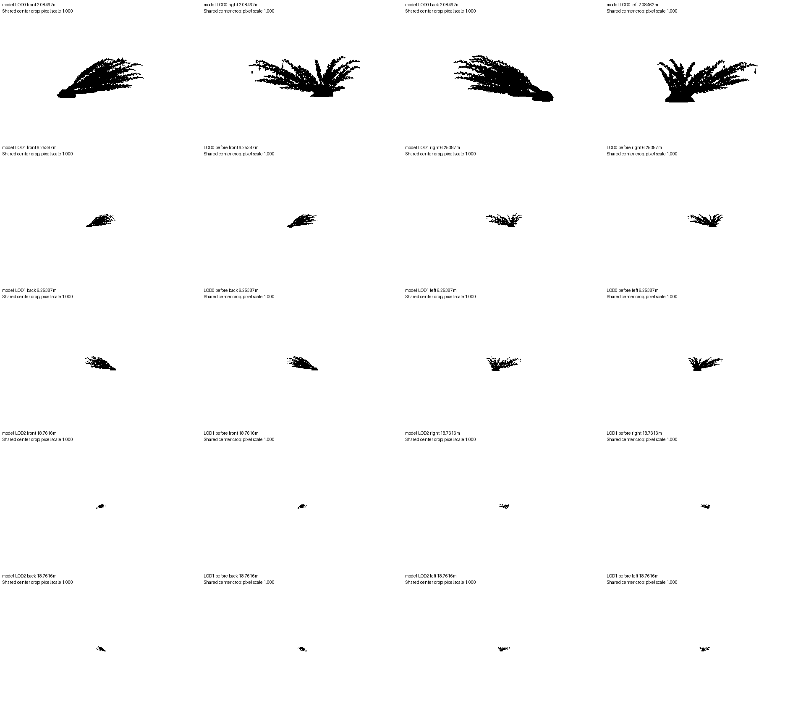

# Model QA

Result: **FAIL**

Mechanical QA only; artistic quality and in-game transitions still need human review.

| Model | LOD | Check | Result | Measurements |
|---|---:|---|---|---|
| specimen-b | 0 | M12 | PASS | 0 floating / 932 parts; 1 poses; 3 mm |
| specimen-b | 0 | M13 | PASS | max 0 major, 1 minor; limit 2/100 parts; 1 poses |
| specimen-b | 0 | M5 | FAIL | max XOR/union=0.000000 / 0.05; 0 missing parts; distance=2.08462m; declared=False |
| specimen-b | 0 | triangles | FAIL | 7288 / 5000 triangles |
| specimen-b | 0 | ecology | FAIL | habitat=False; reasoned traits=0 |
| specimen-b | 1 | M12 | PASS | 0 floating / 485 parts; 1 poses; 3 mm |
| specimen-b | 1 | M13 | PASS | max 0 major, 0 minor; limit 2/100 parts; 1 poses |
| specimen-b | 1 | M5 | FAIL | max XOR/union=0.238247 / 0.05; 815 missing parts; distance=6.25387m; declared=False |
| specimen-b | 1 | triangles | PASS | 4310 / 5000 triangles |
| specimen-b | 1 | ecology | FAIL | habitat=False; reasoned traits=0 |
| specimen-b | 2 | M12 | PASS | 0 floating / 268 parts; 1 poses; 3 mm |
| specimen-b | 2 | M13 | PASS | max 0 major, 0 minor; limit 2/100 parts; 1 poses |
| specimen-b | 2 | M5 | FAIL | max XOR/union=0.253623 / 0.05; 213 missing parts; distance=18.7616m; declared=False |
| specimen-b | 2 | triangles | PASS | 2890 / 5000 triangles |
| specimen-b | 2 | ecology | FAIL | habitat=False; reasoned traits=0 |

## Inputs

- `model-lod0.glb`: `b0e073d97bb1df675a237fe07ca8d04988e3e7041154531a6320bf1ee7908086`
- `model-lod1.glb`: `3de5d9c195f368ad091e1e0ebdffc05a401b87ca2a63c43b8a2e5dfdca35f851`
- `model-lod2.glb`: `40e4c0335dac5b331e62fa64781cec91275304b4a2d0f4940170ee152b6f5eb1`

## Settings

```json
{
  "budget_tris": 5000,
  "switch_distances": null,
  "max_pixel_difference": 0.05,
  "part_match_mm": 3.0,
  "samples": 6,
  "width": 1920,
  "height": 1080,
  "fov": 75
}
```

## Limits

- M12 uses 3 mm contact; M13 fails on any major or more than two minor clips per 100 parts.
- M5 pixel fraction is XOR / union at identical cameras for each adjacent pair. The configured threshold is a mechanical QA policy, not a calibrated perceptual pass.
- Part correspondence flags parts with at most half their vertices near the next LOD surface. This can also flag a moved or strongly simplified part; inspect the named geometry.
- Silhouettes measure opaque geometry, not alpha textures, materials, animation blending, runtime fades or engine visibility ranges.
- Missing switch distances fail M5. Fallback distances produce diagnostic images only.
- Ecology checks document structure, not biological truth.

## Failures and flagged parts

### specimen-b LOD0 M5

```json
{
  "switch_distance_m": 2.0846224326102027,
  "distance_declared": false,
  "valid_chain": true,
  "views": [
    {
      "side": "front",
      "different_pixels": 0,
      "union_pixels": 8679,
      "difference_fraction": 0.0,
      "before_pixels": 8679,
      "after_pixels": 8679,
      "frame_clipped": false
    },
    {
      "side": "right",
      "different_pixels": 0,
      "union_pixels": 10117,
      "difference_fraction": 0.0,
      "before_pixels": 10117,
      "after_pixels": 10117,
      "frame_clipped": false
    },
    {
      "side": "back",
      "different_pixels": 0,
      "union_pixels": 11107,
      "difference_fraction": 0.0,
      "before_pixels": 11107,
      "after_pixels": 11107,
      "frame_clipped": false
    },
    {
      "side": "left",
      "different_pixels": 0,
      "union_pixels": 10334,
      "difference_fraction": 0.0,
      "before_pixels": 10334,
      "after_pixels": 10334,
      "frame_clipped": false
    }
  ],
  "disappeared_parts": []
}
```

### specimen-b LOD0 triangles

```json
{}
```

### specimen-b LOD0 ecology

```json
{
  "result": "FAIL",
  "habitat": "",
  "traits_with_reason": [],
  "sha256": null,
  "reason": "Ecology entry is missing"
}
```

### specimen-b LOD1 M5

```json
{
  "switch_distance_m": 6.253867297830608,
  "distance_declared": false,
  "valid_chain": true,
  "views": [
    {
      "side": "front",
      "different_pixels": 174,
      "union_pixels": 1063,
      "difference_fraction": 0.1636876763875823,
      "before_pixels": 995,
      "after_pixels": 957,
      "frame_clipped": false
    },
    {
      "side": "right",
      "different_pixels": 274,
      "union_pixels": 1223,
      "difference_fraction": 0.22403924775143091,
      "before_pixels": 1114,
      "after_pixels": 1058,
      "frame_clipped": false
    },
    {
      "side": "back",
      "different_pixels": 178,
      "union_pixels": 1171,
      "difference_fraction": 0.1520068317677199,
      "before_pixels": 1098,
      "after_pixels": 1066,
      "frame_clipped": false
    },
    {
      "side": "left",
      "different_pixels": 299,
      "union_pixels": 1255,
      "difference_fraction": 0.23824701195219122,
      "before_pixels": 1131,
      "after_pixels": 1080,
      "frame_clipped": false
    }
  ],
  "disappeared_parts": [
    {
      "part": 0,
      "name": "specimen-b-mesh / part-0",
      "retained_vertex_fraction": 0.47297297297297297,
      "nearest_surface_mm": 0.0,
      "farthest_surface_mm": 24.865439757139164,
      "centroid_m": [
        -0.2985754846236477,
        -0.00962711688752124,
        0.00433245695392874
      ],
      "triangles": 144
    },
    {
      "part": 37,
      "name": "specimen-b-mesh / part-37",
      "retained_vertex_fraction": 0.4,
      "nearest_surface_mm": 0.0,
      "farthest_surface_mm": 5.024919529271649,
      "centroid_m": [
        -0.14137326183110246,
        0.04637027863991242,
        0.07012960361253558
      ],
      "triangles": 4
    },
    {
      "part": 38,
      "name": "specimen-b-mesh / part-38",
      "retained_vertex_fraction": 0.4,
      "nearest_surface_mm": 1.7171707860632863,
      "farthest_surface_mm": 7.287573837561434,
      "centroid_m": [
        -0.12862047320477438,
        0.047289995294583505,
        0.08265381465453572
      ],
      "triangles": 4
    },
    {
      "part": 39,
      "name": "specimen-b-mesh / part-39",
      "retained_vertex_fraction": 0.4,
      "nearest_surface_mm": 0.0,
      "farthest_surface_mm": 5.7540049631090255,
      "centroid_m": [
        -0.11802980522995588,
        0.05955019084500016,
        0.0725918403120905
      ],
      "triangles": 4
    },
    {
      "part": 41,
      "name": "specimen-b-mesh / part-41",
      "retained_vertex_fraction": 0.4,
      "nearest_surface_mm": 0.0,
      "farthest_surface_mm": 6.380976346886958,
      "centroid_m": [
        -0.09566882529576849,
        0.06397219132363888,
        0.09134332953571801
      ],
      "triangles": 4
    },
    {
      "part": 42,
      "name": "specimen-b-mesh / part-42",
      "retained_vertex_fraction": 0.4,
      "nearest_surface_mm": 1.657082142028194,
      "farthest_surface_mm": 12.342943260313149,
      "centroid_m": [
        -0.09191504143172613,
        0.08261332628619647,
        0.08473718513636756
      ],
      "triangles": 4
    },
    {
      "part": 44,
      "name": "specimen-b-mesh / part-44",
      "retained_vertex_fraction": 0.2,
      "nearest_surface_mm": 1.7162154375429943,
      "farthest_surface_mm": 11.725553112490061,
      "centroid_m": [
        -0.06501152263552729,
        0.08465723098237903,
        0.09308223489986102
      ],
      "triangles": 4
    },
    {
      "part": 45,
      "name": "specimen-b-mesh / part-45",
      "retained_vertex_fraction": 0.4,
      "nearest_surface_mm": 0.0,
      "farthest_surface_mm": 5.884871870281009,
      "centroid_m": [
        -0.11004954527589766,
        0.02539377751105154,
        -0.07202149639332901
      ],
      "triangles": 4
    },
    {
      "part": 46,
      "name": "specimen-b-mesh / part-46",
      "retained_vertex_fraction": 0.4,
      "nearest_surface_mm": 0.0,
      "farthest_surface_mm": 6.982439574809365,
      "centroid_m": [
        -0.06242569624026609,
        0.030471511527369172,
        -0.06387081928737194
      ],
      "triangles": 4
    },
    {
      "part": 47,
      "name": "specimen-b-mesh / part-47",
      "retained_vertex_fraction": 0.2,
      "nearest_surface_mm": 1.596120467370175,
      "farthest_surface_mm": 12.13920638030441,
      "centroid_m": [
        -0.05582359647289111,
        0.030480628929496992,
        -0.0854669614980061
      ],
      "triangles": 4
    },
    {
      "part": 48,
      "name": "specimen-b-mesh / part-48",
      "retained_vertex_fraction": 0.4,
      "nearest_surface_mm": 0.0,
      "farthest_surface_mm": 7.086969463057423,
      "centroid_m": [
        -0.04465017756621762,
        0.04554958325647963,
        -0.07322371415856202
      ],
      "triangles": 4
    },
    {
      "part": 49,
      "name": "specimen-b-mesh / part-49",
      "retained_vertex_fraction": 0.4,
      "nearest_surface_mm": 0.0,
      "farthest_surface_mm": 6.859153597420439,
      "centroid_m": [
        -0.0266255853846766,
        0.04313537918861983,
        -0.09188573439956964
      ],
      "triangles": 4
    },
    {
      "part": 50,
      "name": "specimen-b-mesh / part-50",
      "retained_vertex_fraction": 0.2,
      "nearest_surface_mm": 1.4880190859535556,
      "farthest_surface_mm": 11.774334058691805,
      "centroid_m": [
        -0.01245974961686436,
        0.043952009573164905,
        -0.07495434174561244
      ],
      "triangles": 4
    },
    {
      "part": 51,
      "name": "specimen-b-mesh / part-51",
      "retained_vertex_fraction": 0.4,
      "nearest_surface_mm": 0.0,
      "farthest_surface_mm": 6.332622055128766,
      "centroid_m": [
        -0.00403331544453257,
        0.03351179497888993,
        -0.0918700624177491
      ],
      "triangles": 4
    },
    {
      "part": 52,
      "name": "specimen-b-mesh / part-52",
      "retained_vertex_fraction": 0.2,
      "nearest_surface_mm": 1.7610432796720412,
      "farthest_surface_mm": 7.908064814341632,
      "centroid_m": [
        -0.20421553359143635,
        0.09436060827275672,
        0.21897959514224113
      ],
      "triangles": 4
    },
    {
      "part": 54,
      "name": "specimen-b-mesh / part-54",
      "retained_vertex_fraction": 0.2,
      "nearest_surface_mm": 1.7071064263915778,
      "farthest_surface_mm": 12.792499933701974,
      "centroid_m": [
        -0.19880458243457727,
        0.11489689561503887,
        0.2328884846424379
      ],
      "triangles": 4
    },
    {
      "part": 55,
      "name": "specimen-b-mesh / part-55",
      "retained_vertex_fraction": 0.4,
      "nearest_surface_mm": 0.0,
      "farthest_surface_mm": 6.162599969223613,
      "centroid_m": [
        -0.18244274337327165,
        0.10865183022883688,
        0.24392368384361449
      ],
      "triangles": 4
    },
    {
      "part": 56,
      "name": "specimen-b-mesh / part-56",
      "retained_vertex_fraction": 0.4,
      "nearest_surface_mm": 0.0,
      "farthest_surface_mm": 5.031409210289393,
      "centroid_m": [
        -0.021734131848489182,
        0.08254548289666393,
        -0.011235488960625048
      ],
      "triangles": 4
    },
    {
      "part": 57,
      "name": "specimen-b-mesh / part-57",
      "retained_vertex_fraction": 0.2,
      "nearest_surface_mm": 1.7323309476359685,
      "farthest_surface_mm": 7.482686490554557,
      "centroid_m": [
        -0.005132605985939173,
        0.07896056149281805,
        -0.008529655558922345
      ],
      "triangles": 4
    },
    {
      "part": 58,
      "name": "specimen-b-mesh / part-58",
      "retained_vertex_fraction": 0.4,
      "nearest_surface_mm": 0.0,
      "farthest_surface_mm": 5.7836871509046475,
      "centroid_m": [
        0.0002569478324600362,
        0.08875295170562354,
        -0.022847566665596085
      ],
      "triangles": 4
    }
  ],
  "additional_flagged_parts": 795,
  "full_evidence": "report.json"
}
```

### specimen-b LOD1 ecology

```json
{
  "result": "FAIL",
  "habitat": "",
  "traits_with_reason": [],
  "sha256": null,
  "reason": "Ecology entry is missing"
}
```

### specimen-b LOD2 M5

```json
{
  "switch_distance_m": 18.761601893491825,
  "distance_declared": false,
  "valid_chain": true,
  "views": [
    {
      "side": "front",
      "different_pixels": 19,
      "union_pixels": 118,
      "difference_fraction": 0.16101694915254236,
      "before_pixels": 109,
      "after_pixels": 108,
      "frame_clipped": false
    },
    {
      "side": "right",
      "different_pixels": 35,
      "union_pixels": 138,
      "difference_fraction": 0.2536231884057971,
      "before_pixels": 119,
      "after_pixels": 122,
      "frame_clipped": false
    },
    {
      "side": "back",
      "different_pixels": 21,
      "union_pixels": 127,
      "difference_fraction": 0.16535433070866143,
      "before_pixels": 118,
      "after_pixels": 115,
      "frame_clipped": false
    },
    {
      "side": "left",
      "different_pixels": 32,
      "union_pixels": 143,
      "difference_fraction": 0.22377622377622378,
      "before_pixels": 124,
      "after_pixels": 130,
      "frame_clipped": false
    }
  ],
  "disappeared_parts": [
    {
      "part": 38,
      "name": "specimen-b-mesh / part-38",
      "retained_vertex_fraction": 0.25,
      "nearest_surface_mm": 0.9041099154041938,
      "farthest_surface_mm": 12.618637074166527,
      "centroid_m": [
        -0.11535160617444794,
        0.0618428675000876,
        0.07202154894663725
      ],
      "triangles": 2
    },
    {
      "part": 40,
      "name": "specimen-b-mesh / part-40",
      "retained_vertex_fraction": 0.5,
      "nearest_surface_mm": 1.1868025419110957,
      "farthest_surface_mm": 4.21881137337862,
      "centroid_m": [
        -0.08110312837776726,
        0.08312430197304259,
        0.10927356280698866
      ],
      "triangles": 2
    },
    {
      "part": 41,
      "name": "specimen-b-mesh / part-41",
      "retained_vertex_fraction": 0.25,
      "nearest_surface_mm": 0.9965105666568457,
      "farthest_surface_mm": 15.707220189661644,
      "centroid_m": [
        -0.10734421533640678,
        0.02619082584076528,
        -0.0743424891989216
      ],
      "triangles": 2
    },
    {
      "part": 42,
      "name": "specimen-b-mesh / part-42",
      "retained_vertex_fraction": 0.25,
      "nearest_surface_mm": 1.0688965868264817,
      "farthest_surface_mm": 14.538824138933215,
      "centroid_m": [
        -0.05831458356556224,
        0.030633845916208338,
        -0.0625091965191799
      ],
      "triangles": 2
    },
    {
      "part": 44,
      "name": "specimen-b-mesh / part-44",
      "retained_vertex_fraction": 0.25,
      "nearest_surface_mm": 0.7065652068395394,
      "farthest_surface_mm": 18.03906378952746,
      "centroid_m": [
        -0.023813751205882198,
        0.04458631032901031,
        -0.09473400072688039
      ],
      "triangles": 2
    },
    {
      "part": 46,
      "name": "specimen-b-mesh / part-46",
      "retained_vertex_fraction": 0.25,
      "nearest_surface_mm": 0.8777064101558931,
      "farthest_surface_mm": 11.64517881587521,
      "centroid_m": [
        -0.18986707020194069,
        0.11053095874855959,
        0.2184813166479406
      ],
      "triangles": 2
    },
    {
      "part": 49,
      "name": "specimen-b-mesh / part-49",
      "retained_vertex_fraction": 0.25,
      "nearest_surface_mm": 0.8835151917228515,
      "farthest_surface_mm": 10.183236620295697,
      "centroid_m": [
        0.002615169792095624,
        0.09056093788713883,
        -0.024861583809809792
      ],
      "triangles": 2
    },
    {
      "part": 51,
      "name": "specimen-b-mesh / part-51",
      "retained_vertex_fraction": 0.5,
      "nearest_surface_mm": 1.2342568470113071,
      "farthest_surface_mm": 13.842244259862431,
      "centroid_m": [
        0.05211322116259756,
        0.09819569998974706,
        -0.012507471721855432
      ],
      "triangles": 2
    },
    {
      "part": 53,
      "name": "specimen-b-mesh / part-53",
      "retained_vertex_fraction": 0.25,
      "nearest_surface_mm": 0.728264920581369,
      "farthest_surface_mm": 21.968133886051433,
      "centroid_m": [
        0.08622777228763284,
        0.12115820921842001,
        -0.04143729663890808
      ],
      "triangles": 2
    },
    {
      "part": 55,
      "name": "specimen-b-mesh / part-55",
      "retained_vertex_fraction": 0.25,
      "nearest_surface_mm": 1.0571314303577615,
      "farthest_surface_mm": 18.118147979663497,
      "centroid_m": [
        0.1323715124074633,
        0.12181186746678678,
        -0.02657061656992442
      ],
      "triangles": 2
    },
    {
      "part": 57,
      "name": "specimen-b-mesh / part-57",
      "retained_vertex_fraction": 0.25,
      "nearest_surface_mm": 0.6327512484427653,
      "farthest_surface_mm": 13.26445454470472,
      "centroid_m": [
        0.1652339298411031,
        0.1426489414688515,
        -0.04989720883922529
      ],
      "triangles": 2
    },
    {
      "part": 60,
      "name": "specimen-b-mesh / part-60",
      "retained_vertex_fraction": 0.25,
      "nearest_surface_mm": 0.9727302387303136,
      "farthest_surface_mm": 16.4116754714178,
      "centroid_m": [
        -0.1088595141340534,
        0.03451754280705179,
        0.059106383475538996
      ],
      "triangles": 2
    },
    {
      "part": 64,
      "name": "specimen-b-mesh / part-64",
      "retained_vertex_fraction": 0.25,
      "nearest_surface_mm": 1.0635559451742032,
      "farthest_surface_mm": 10.065520035694126,
      "centroid_m": [
        -0.06075977513844817,
        0.06469606337439121,
        -0.07735141608779379
      ],
      "triangles": 2
    },
    {
      "part": 66,
      "name": "specimen-b-mesh / part-66",
      "retained_vertex_fraction": 0.25,
      "nearest_surface_mm": 1.2693742565899764,
      "farthest_surface_mm": 11.128090375456669,
      "centroid_m": [
        -0.012124643512805205,
        0.08876681782743404,
        -0.0670700535703962
      ],
      "triangles": 2
    },
    {
      "part": 67,
      "name": "specimen-b-mesh / part-67",
      "retained_vertex_fraction": 0.25,
      "nearest_surface_mm": 0.7736136561725152,
      "farthest_surface_mm": 18.51897085125365,
      "centroid_m": [
        0.019808021097598487,
        0.11837958257955773,
        -0.09778274619184597
      ],
      "triangles": 2
    },
    {
      "part": 71,
      "name": "specimen-b-mesh / part-71",
      "retained_vertex_fraction": 0.25,
      "nearest_surface_mm": 1.0764146047113363,
      "farthest_surface_mm": 13.53653705463024,
      "centroid_m": [
        -0.037641766437103145,
        0.07962067569193067,
        -0.033714991752157385
      ],
      "triangles": 2
    },
    {
      "part": 75,
      "name": "specimen-b-mesh / part-75",
      "retained_vertex_fraction": 0.25,
      "nearest_surface_mm": 1.019188382749698,
      "farthest_surface_mm": 17.62797198009962,
      "centroid_m": [
        0.0818960393594443,
        0.10109631990068908,
        -0.08233789095350554
      ],
      "triangles": 2
    },
    {
      "part": 77,
      "name": "specimen-b-mesh / part-77",
      "retained_vertex_fraction": 0.5,
      "nearest_surface_mm": 0.44766561173726027,
      "farthest_surface_mm": 13.082298498284368,
      "centroid_m": [
        -0.1815598766905463,
        0.07017358299242121,
        0.04471245501932862
      ],
      "triangles": 2
    },
    {
      "part": 78,
      "name": "specimen-b-mesh / part-78",
      "retained_vertex_fraction": 0.25,
      "nearest_surface_mm": 0.9675849949178639,
      "farthest_surface_mm": 19.745187751105714,
      "centroid_m": [
        -0.16160646570795734,
        0.09988717971504639,
        0.0911210974649682
      ],
      "triangles": 2
    },
    {
      "part": 80,
      "name": "specimen-b-mesh / part-80",
      "retained_vertex_fraction": 0.25,
      "nearest_surface_mm": 0.8951166128358938,
      "farthest_surface_mm": 17.67329051771099,
      "centroid_m": [
        -0.09355274666331674,
        0.07223904310790673,
        -0.05869033293199139
      ],
      "triangles": 2
    }
  ],
  "additional_flagged_parts": 193,
  "full_evidence": "report.json"
}
```

### specimen-b LOD2 ecology

```json
{
  "result": "FAIL",
  "habitat": "",
  "traits_with_reason": [],
  "sha256": null,
  "reason": "Ecology entry is missing"
}
```


## Silhouettes



The contact sheet uses one shared center crop with its pixel scale labelled. Full resolution PNGs are in `silhouettes/`.
Each transition includes both LODs at the incoming LOD's distance.
