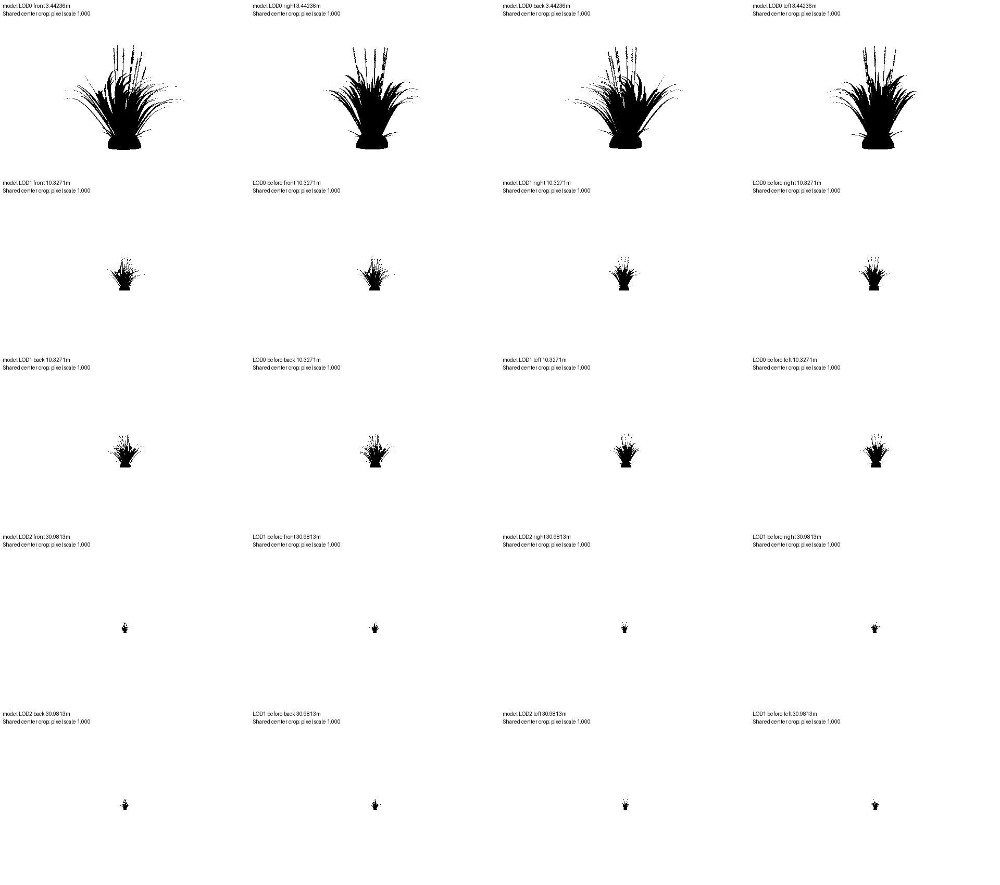

# Model QA

Result: **FAIL**

Mechanical QA only; artistic quality and in-game transitions still need human review.

| Model | LOD | Check | Result | Measurements |
|---|---:|---|---|---|
| specimen-c | 0 | M12 | PASS | 0 floating / 242 parts; 1 poses; 3 mm |
| specimen-c | 0 | M13 | PASS | max 0 major, 0 minor; limit 2/100 parts; 1 poses |
| specimen-c | 0 | M5 | FAIL | max XOR/union=0.000000 / 0.05; 0 missing parts; distance=3.44236m; declared=False |
| specimen-c | 0 | triangles | FAIL | 4400 / 2000 triangles |
| specimen-c | 0 | ecology | FAIL | habitat=False; reasoned traits=0 |
| specimen-c | 1 | M12 | PASS | 0 floating / 162 parts; 1 poses; 3 mm |
| specimen-c | 1 | M13 | PASS | max 0 major, 0 minor; limit 2/100 parts; 1 poses |
| specimen-c | 1 | M5 | FAIL | max XOR/union=0.146517 / 0.05; 45 missing parts; distance=10.3271m; declared=False |
| specimen-c | 1 | triangles | FAIL | 2028 / 2000 triangles |
| specimen-c | 1 | ecology | FAIL | habitat=False; reasoned traits=0 |
| specimen-c | 2 | M12 | PASS | 0 floating / 90 parts; 1 poses; 3 mm |
| specimen-c | 2 | M13 | PASS | max 0 major, 0 minor; limit 2/100 parts; 1 poses |
| specimen-c | 2 | M5 | FAIL | max XOR/union=0.261745 / 0.05; 72 missing parts; distance=30.9813m; declared=False |
| specimen-c | 2 | triangles | PASS | 1378 / 2000 triangles |
| specimen-c | 2 | ecology | FAIL | habitat=False; reasoned traits=0 |

## Inputs

- `model-lod0.glb`: `33e1528b576caeaac46e35e326de70c2bf20c1647538676e6e0f0e89fe23c46c`
- `model-lod1.glb`: `336c16da9ee3faa9e3e3e040df383d8869e41ce073161b76ff40199d4e8d7807`
- `model-lod2.glb`: `0aabac4d303d67fabc00ddf614a60081a3cf6cec1132c3707697166194e99667`

## Settings

```json
{
  "budget_tris": 2000,
  "switch_distances": null,
  "max_pixel_difference": 0.05,
  "part_match_mm": 3.0,
  "samples": 6,
  "width": 1920,
  "height": 1080,
  "fov": 75
}
```

## Limits

- M12 uses 3 mm contact; M13 fails on any major or more than two minor clips per 100 parts.
- M5 pixel fraction is XOR / union at identical cameras for each adjacent pair. The configured threshold is a mechanical QA policy, not a calibrated perceptual pass.
- Part correspondence flags parts with at most half their vertices near the next LOD surface. This can also flag a moved or strongly simplified part; inspect the named geometry.
- Silhouettes measure opaque geometry, not alpha textures, materials, animation blending, runtime fades or engine visibility ranges.
- Missing switch distances fail M5. Fallback distances produce diagnostic images only.
- Ecology checks document structure, not biological truth.

## Failures and flagged parts

### specimen-c LOD0 M5

```json
{
  "switch_distance_m": 3.442363480577678,
  "distance_declared": false,
  "valid_chain": true,
  "views": [
    {
      "side": "front",
      "different_pixels": 0,
      "union_pixels": 10513,
      "difference_fraction": 0.0,
      "before_pixels": 10513,
      "after_pixels": 10513,
      "frame_clipped": false
    },
    {
      "side": "right",
      "different_pixels": 0,
      "union_pixels": 9904,
      "difference_fraction": 0.0,
      "before_pixels": 9904,
      "after_pixels": 9904,
      "frame_clipped": false
    },
    {
      "side": "back",
      "different_pixels": 0,
      "union_pixels": 10350,
      "difference_fraction": 0.0,
      "before_pixels": 10350,
      "after_pixels": 10350,
      "frame_clipped": false
    },
    {
      "side": "left",
      "different_pixels": 0,
      "union_pixels": 9859,
      "difference_fraction": 0.0,
      "before_pixels": 9859,
      "after_pixels": 9859,
      "frame_clipped": false
    }
  ],
  "disappeared_parts": []
}
```

### specimen-c LOD0 triangles

```json
{}
```

### specimen-c LOD0 ecology

```json
{
  "result": "FAIL",
  "habitat": "",
  "traits_with_reason": [],
  "sha256": null,
  "reason": "Ecology entry is missing"
}
```

### specimen-c LOD1 M5

```json
{
  "switch_distance_m": 10.327090441733034,
  "distance_declared": false,
  "valid_chain": true,
  "views": [
    {
      "side": "front",
      "different_pixels": 176,
      "union_pixels": 1231,
      "difference_fraction": 0.1429731925264013,
      "before_pixels": 1135,
      "after_pixels": 1151,
      "frame_clipped": false
    },
    {
      "side": "right",
      "different_pixels": 105,
      "union_pixels": 1135,
      "difference_fraction": 0.09251101321585903,
      "before_pixels": 1094,
      "after_pixels": 1071,
      "frame_clipped": false
    },
    {
      "side": "back",
      "different_pixels": 183,
      "union_pixels": 1249,
      "difference_fraction": 0.1465172137710168,
      "before_pixels": 1162,
      "after_pixels": 1153,
      "frame_clipped": false
    },
    {
      "side": "left",
      "different_pixels": 79,
      "union_pixels": 1111,
      "difference_fraction": 0.0711071107110711,
      "before_pixels": 1076,
      "after_pixels": 1067,
      "frame_clipped": false
    }
  ],
  "disappeared_parts": [
    {
      "part": 87,
      "name": "specimen-c-mesh / part-87",
      "retained_vertex_fraction": 0.3333333333333333,
      "nearest_surface_mm": 0.8558482052673676,
      "farthest_surface_mm": 6.41730721648239,
      "centroid_m": [
        0.15321099804666755,
        0.7850360490504582,
        -0.024383003560275784
      ],
      "triangles": 8
    },
    {
      "part": 89,
      "name": "specimen-c-mesh / part-89",
      "retained_vertex_fraction": 0.3333333333333333,
      "nearest_surface_mm": 0.8247920685208544,
      "farthest_surface_mm": 6.568803696314166,
      "centroid_m": [
        0.15023970062233027,
        0.8002905764917405,
        -0.023097481304167677
      ],
      "triangles": 8
    },
    {
      "part": 91,
      "name": "specimen-c-mesh / part-91",
      "retained_vertex_fraction": 0.3333333333333333,
      "nearest_surface_mm": 0.8010542380496875,
      "farthest_surface_mm": 6.4285902275749995,
      "centroid_m": [
        0.15094704388626243,
        0.8141960391239554,
        -0.029240784089524578
      ],
      "triangles": 8
    },
    {
      "part": 93,
      "name": "specimen-c-mesh / part-93",
      "retained_vertex_fraction": 0.3333333333333333,
      "nearest_surface_mm": 0.7712264925450242,
      "farthest_surface_mm": 5.82861750133925,
      "centroid_m": [
        0.15899842151282179,
        0.8263198187213646,
        -0.031889500910243895
      ],
      "triangles": 8
    },
    {
      "part": 95,
      "name": "specimen-c-mesh / part-95",
      "retained_vertex_fraction": 0.3333333333333333,
      "nearest_surface_mm": 0.7345165422282413,
      "farthest_surface_mm": 5.018268606036039,
      "centroid_m": [
        0.1641314080729943,
        0.8388977549375385,
        -0.0273075886316199
      ],
      "triangles": 8
    },
    {
      "part": 99,
      "name": "specimen-c-mesh / part-99",
      "retained_vertex_fraction": 0.3333333333333333,
      "nearest_surface_mm": 0.6801337820258444,
      "farthest_surface_mm": 4.330016899796777,
      "centroid_m": [
        0.16254717174621405,
        0.8669650988429985,
        -0.028988275517654594
      ],
      "triangles": 8
    },
    {
      "part": 101,
      "name": "specimen-c-mesh / part-101",
      "retained_vertex_fraction": 0.3333333333333333,
      "nearest_surface_mm": 0.596347864670851,
      "farthest_surface_mm": 4.459608562797011,
      "centroid_m": [
        0.16861091996337751,
        0.8800276165192086,
        -0.03261769808499411
      ],
      "triangles": 8
    },
    {
      "part": 105,
      "name": "specimen-c-mesh / part-105",
      "retained_vertex_fraction": 0.3333333333333333,
      "nearest_surface_mm": 0.9808213466930285,
      "farthest_surface_mm": 5.433446114792997,
      "centroid_m": [
        0.11329788905340227,
        0.7228965372888255,
        -0.11171599824717994
      ],
      "triangles": 8
    },
    {
      "part": 107,
      "name": "specimen-c-mesh / part-107",
      "retained_vertex_fraction": 0.3333333333333333,
      "nearest_surface_mm": 0.8933190470365037,
      "farthest_surface_mm": 6.210448198271953,
      "centroid_m": [
        0.12123083030029444,
        0.7356072387653735,
        -0.11120231923350561
      ],
      "triangles": 8
    },
    {
      "part": 109,
      "name": "specimen-c-mesh / part-109",
      "retained_vertex_fraction": 0.3333333333333333,
      "nearest_surface_mm": 0.8129748095299671,
      "farthest_surface_mm": 6.637331929998518,
      "centroid_m": [
        0.1219562852828932,
        0.7497410274520492,
        -0.10704390593720019
      ],
      "triangles": 8
    },
    {
      "part": 111,
      "name": "specimen-c-mesh / part-111",
      "retained_vertex_fraction": 0.3333333333333333,
      "nearest_surface_mm": 0.7400598707452588,
      "farthest_surface_mm": 6.741921345844046,
      "centroid_m": [
        0.11847065659251724,
        0.7633453858397015,
        -0.11013302487735545
      ],
      "triangles": 8
    },
    {
      "part": 113,
      "name": "specimen-c-mesh / part-113",
      "retained_vertex_fraction": 0.3333333333333333,
      "nearest_surface_mm": 0.6615345827220621,
      "farthest_surface_mm": 6.371118111085889,
      "centroid_m": [
        0.12181796526205134,
        0.7747466605712181,
        -0.1174316829802744
      ],
      "triangles": 8
    },
    {
      "part": 125,
      "name": "specimen-c-mesh / part-125",
      "retained_vertex_fraction": 0.3333333333333333,
      "nearest_surface_mm": 1.0388041811890443,
      "farthest_surface_mm": 5.2991969946812665,
      "centroid_m": [
        0.07584167113549516,
        0.7859588682686205,
        -0.12816035424272826
      ],
      "triangles": 8
    },
    {
      "part": 127,
      "name": "specimen-c-mesh / part-127",
      "retained_vertex_fraction": 0.3333333333333333,
      "nearest_surface_mm": 1.0347867536697548,
      "farthest_surface_mm": 5.916142765741665,
      "centroid_m": [
        0.08250803679523643,
        0.7995838501304707,
        -0.133532563647252
      ],
      "triangles": 8
    },
    {
      "part": 129,
      "name": "specimen-c-mesh / part-129",
      "retained_vertex_fraction": 0.3333333333333333,
      "nearest_surface_mm": 1.0372179473152872,
      "farthest_surface_mm": 6.202911161734421,
      "centroid_m": [
        0.08839702462819081,
        0.8140273059768521,
        -0.13078185154237743
      ],
      "triangles": 8
    },
    {
      "part": 131,
      "name": "specimen-c-mesh / part-131",
      "retained_vertex_fraction": 0.3333333333333333,
      "nearest_surface_mm": 0.991237875478506,
      "farthest_surface_mm": 6.135401255241636,
      "centroid_m": [
        0.08592565744162155,
        0.8291190500542611,
        -0.12850471690837512
      ],
      "triangles": 8
    },
    {
      "part": 133,
      "name": "specimen-c-mesh / part-133",
      "retained_vertex_fraction": 0.3333333333333333,
      "nearest_surface_mm": 0.8677267429957134,
      "farthest_surface_mm": 5.779198178066836,
      "centroid_m": [
        0.08348565016769947,
        0.8427214367330813,
        -0.13435614707085622
      ],
      "triangles": 8
    },
    {
      "part": 135,
      "name": "specimen-c-mesh / part-135",
      "retained_vertex_fraction": 0.3333333333333333,
      "nearest_surface_mm": 0.7365899081504409,
      "farthest_surface_mm": 5.06868958107676,
      "centroid_m": [
        0.08875700919533888,
        0.8549208920505504,
        -0.1403647676839686
      ],
      "triangles": 8
    },
    {
      "part": 147,
      "name": "specimen-c-mesh / part-147",
      "retained_vertex_fraction": 0.3333333333333333,
      "nearest_surface_mm": 0.8350752428235402,
      "farthest_surface_mm": 6.59021475391765,
      "centroid_m": [
        -0.010314176576553155,
        0.8150984906671312,
        -0.11294251995982986
      ],
      "triangles": 8
    },
    {
      "part": 149,
      "name": "specimen-c-mesh / part-149",
      "retained_vertex_fraction": 0.3333333333333333,
      "nearest_surface_mm": 0.7918843969507922,
      "farthest_surface_mm": 6.791377213636402,
      "centroid_m": [
        -0.003622496683110907,
        0.8293882019681845,
        -0.11536699167625658
      ],
      "triangles": 8
    }
  ],
  "additional_flagged_parts": 25,
  "full_evidence": "report.json"
}
```

### specimen-c LOD1 triangles

```json
{}
```

### specimen-c LOD1 ecology

```json
{
  "result": "FAIL",
  "habitat": "",
  "traits_with_reason": [],
  "sha256": null,
  "reason": "Ecology entry is missing"
}
```

### specimen-c LOD2 M5

```json
{
  "switch_distance_m": 30.981271325199103,
  "distance_declared": false,
  "valid_chain": true,
  "views": [
    {
      "side": "front",
      "different_pixels": 37,
      "union_pixels": 145,
      "difference_fraction": 0.25517241379310346,
      "before_pixels": 131,
      "after_pixels": 122,
      "frame_clipped": false
    },
    {
      "side": "right",
      "different_pixels": 27,
      "union_pixels": 133,
      "difference_fraction": 0.20300751879699247,
      "before_pixels": 126,
      "after_pixels": 113,
      "frame_clipped": false
    },
    {
      "side": "back",
      "different_pixels": 39,
      "union_pixels": 149,
      "difference_fraction": 0.26174496644295303,
      "before_pixels": 131,
      "after_pixels": 128,
      "frame_clipped": false
    },
    {
      "side": "left",
      "different_pixels": 26,
      "union_pixels": 130,
      "difference_fraction": 0.2,
      "before_pixels": 122,
      "after_pixels": 112,
      "frame_clipped": false
    }
  ],
  "disappeared_parts": [
    {
      "part": 0,
      "name": "specimen-c-mesh / part-0",
      "retained_vertex_fraction": 0.4583333333333333,
      "nearest_surface_mm": 0.0,
      "farthest_surface_mm": 25.47763292892767,
      "centroid_m": [
        0.0018894198792749988,
        0.030040005090179633,
        -0.0006777045672352737
      ],
      "triangles": 140
    },
    {
      "part": 72,
      "name": "specimen-c-mesh / part-72",
      "retained_vertex_fraction": 0.5,
      "nearest_surface_mm": 0.0,
      "farthest_surface_mm": 30.632513098689827,
      "centroid_m": [
        -0.09790923802505226,
        0.3493655233324958,
        -0.03770173876337464
      ],
      "triangles": 20
    },
    {
      "part": 82,
      "name": "specimen-c-mesh / part-82",
      "retained_vertex_fraction": 0.25,
      "nearest_surface_mm": 0.8904982519291046,
      "farthest_surface_mm": 4.833384192629275,
      "centroid_m": [
        0.14688275754451752,
        0.7492387096108868,
        -0.025885837687051286
      ],
      "triangles": 2
    },
    {
      "part": 83,
      "name": "specimen-c-mesh / part-83",
      "retained_vertex_fraction": 0.5,
      "nearest_surface_mm": 0.44604174002691505,
      "farthest_surface_mm": 6.40918667648741,
      "centroid_m": [
        0.14583539000870246,
        0.7651223340988563,
        -0.02112801872371281
      ],
      "triangles": 2
    },
    {
      "part": 85,
      "name": "specimen-c-mesh / part-85",
      "retained_vertex_fraction": 0.5,
      "nearest_surface_mm": 0.049887924910753396,
      "farthest_surface_mm": 7.7293694326988565,
      "centroid_m": [
        0.14967419434006332,
        0.7942843035150171,
        -0.03275648813885904
      ],
      "triangles": 2
    },
    {
      "part": 86,
      "name": "specimen-c-mesh / part-86",
      "retained_vertex_fraction": 0.25,
      "nearest_surface_mm": 0.47166550680504066,
      "farthest_surface_mm": 7.908496918386771,
      "centroid_m": [
        0.15944703957331752,
        0.8068427840343783,
        -0.029380887231655068
      ],
      "triangles": 2
    },
    {
      "part": 87,
      "name": "specimen-c-mesh / part-87",
      "retained_vertex_fraction": 0.25,
      "nearest_surface_mm": 0.20405392436010236,
      "farthest_surface_mm": 8.46489851877925,
      "centroid_m": [
        0.1590054091875425,
        0.821031908045883,
        -0.022496513732703942
      ],
      "triangles": 2
    },
    {
      "part": 88,
      "name": "specimen-c-mesh / part-88",
      "retained_vertex_fraction": 0.25,
      "nearest_surface_mm": 0.27836489890696975,
      "farthest_surface_mm": 7.130462521070736,
      "centroid_m": [
        0.1548469695011067,
        0.8353091481092998,
        -0.025400901788417463
      ],
      "triangles": 2
    },
    {
      "part": 89,
      "name": "specimen-c-mesh / part-89",
      "retained_vertex_fraction": 0.25,
      "nearest_surface_mm": 0.5115147550309513,
      "farthest_surface_mm": 5.751036191588173,
      "centroid_m": [
        0.1593063571908759,
        0.847469548409375,
        -0.032189555695894885
      ],
      "triangles": 2
    },
    {
      "part": 90,
      "name": "specimen-c-mesh / part-90",
      "retained_vertex_fraction": 0.25,
      "nearest_surface_mm": 0.08925900428267736,
      "farthest_surface_mm": 5.858317575531225,
      "centroid_m": [
        0.16798262721520596,
        0.8595620593697876,
        -0.03149585266587959
      ],
      "triangles": 2
    },
    {
      "part": 91,
      "name": "specimen-c-mesh / part-91",
      "retained_vertex_fraction": 0.25,
      "nearest_surface_mm": 0.007390542333917541,
      "farthest_surface_mm": 6.054724155742579,
      "centroid_m": [
        0.17058659623804454,
        0.8735582629141815,
        -0.02590654821546461
      ],
      "triangles": 2
    },
    {
      "part": 92,
      "name": "specimen-c-mesh / part-92",
      "retained_vertex_fraction": 0.5,
      "nearest_surface_mm": 0.3916133601559118,
      "farthest_surface_mm": 5.9640610017551365,
      "centroid_m": [
        0.11339677750289043,
        0.7025033631552019,
        -0.10909148219476816
      ],
      "triangles": 2
    },
    {
      "part": 93,
      "name": "specimen-c-mesh / part-93",
      "retained_vertex_fraction": 0.25,
      "nearest_surface_mm": 0.5073080945653686,
      "farthest_surface_mm": 6.468142776532929,
      "centroid_m": [
        0.11811914168477358,
        0.7168566391261876,
        -0.10457176226309986
      ],
      "triangles": 2
    },
    {
      "part": 94,
      "name": "specimen-c-mesh / part-94",
      "retained_vertex_fraction": 0.5,
      "nearest_surface_mm": 0.05256321741072647,
      "farthest_surface_mm": 6.609014048549582,
      "centroid_m": [
        0.11406636986205856,
        0.7321807940760101,
        -0.10362226017946456
      ],
      "triangles": 2
    },
    {
      "part": 96,
      "name": "specimen-c-mesh / part-96",
      "retained_vertex_fraction": 0.25,
      "nearest_surface_mm": 0.28392542023257417,
      "farthest_surface_mm": 8.519392931948197,
      "centroid_m": [
        0.12245514974483698,
        0.7564435404744257,
        -0.11774422511265233
      ],
      "triangles": 2
    },
    {
      "part": 97,
      "name": "specimen-c-mesh / part-97",
      "retained_vertex_fraction": 0.25,
      "nearest_surface_mm": 0.5898011743806747,
      "farthest_surface_mm": 7.346340365375984,
      "centroid_m": [
        0.1291034594512979,
        0.7688690622273847,
        -0.11264589454064892
      ],
      "triangles": 2
    },
    {
      "part": 98,
      "name": "specimen-c-mesh / part-98",
      "retained_vertex_fraction": 0.25,
      "nearest_surface_mm": 0.30125304896991895,
      "farthest_surface_mm": 7.023831509582168,
      "centroid_m": [
        0.1256680403064474,
        0.7825009628474167,
        -0.10977869993844847
      ],
      "triangles": 2
    },
    {
      "part": 99,
      "name": "specimen-c-mesh / part-99",
      "retained_vertex_fraction": 0.25,
      "nearest_surface_mm": 0.0875057616755167,
      "farthest_surface_mm": 6.785746578369344,
      "centroid_m": [
        0.12361212320927728,
        0.7944397329676991,
        -0.1163700849111221
      ],
      "triangles": 2
    },
    {
      "part": 100,
      "name": "specimen-c-mesh / part-100",
      "retained_vertex_fraction": 0.25,
      "nearest_surface_mm": 0.23542550015314379,
      "farthest_surface_mm": 5.499236452164773,
      "centroid_m": [
        0.13006760591696834,
        0.8054212532204115,
        -0.12231928597636019
      ],
      "triangles": 2
    },
    {
      "part": 101,
      "name": "specimen-c-mesh / part-101",
      "retained_vertex_fraction": 0.25,
      "nearest_surface_mm": 0.2979866152815051,
      "farthest_surface_mm": 5.424988582497158,
      "centroid_m": [
        0.1373625394356879,
        0.8177637257915423,
        -0.12040035331455914
      ],
      "triangles": 2
    }
  ],
  "additional_flagged_parts": 52,
  "full_evidence": "report.json"
}
```

### specimen-c LOD2 ecology

```json
{
  "result": "FAIL",
  "habitat": "",
  "traits_with_reason": [],
  "sha256": null,
  "reason": "Ecology entry is missing"
}
```


## Silhouettes



The contact sheet uses one shared center crop with its pixel scale labelled. Full resolution PNGs are in `silhouettes/`.
Each transition includes both LODs at the incoming LOD's distance.
